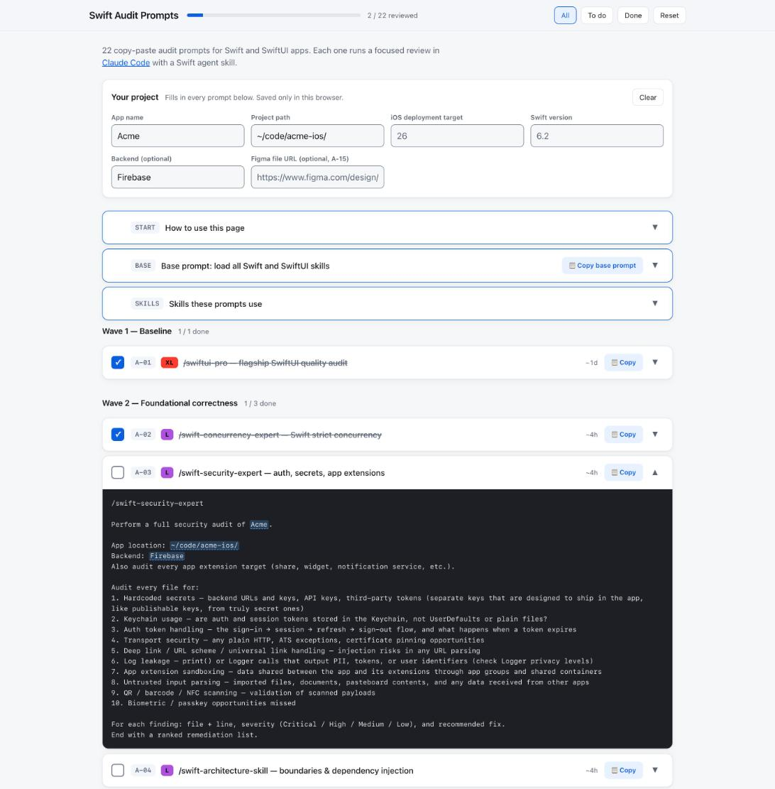

# Swift Audit Prompts

 

22 copy-paste audit prompts for Swift and SwiftUI apps. Each one runs a focused review in [Claude Code](https://claude.com/claude-code) with a Swift agent skill, covering concurrency, security, architecture, performance, accessibility, Liquid Glass, testing, interface copy and more.

**[Open the page](https://mvoshell652.github.io/swift-audit-prompts/)**

Fill in your project once and every prompt updates. Copy an audit into a fresh Claude Code session, and mark it done once you've triaged what it finds.

## Why

A skill knows what good Swift looks like, but `/swiftui-pro` on its own doesn't say what to audit, where to look or what to hand back. Each prompt here does. It names what to read and what to check, and asks for findings by file and line with a fix for each, so you get a list you can triage. A few ask for a plan, a checklist or a recommendation instead.

## The prompts

<!-- prompts:start -->
| Audit | Skill | Time |
|---|---|---|
| **[A-01](https://mvoshell652.github.io/swift-audit-prompts/#A-01)** SwiftUI quality baseline | `/swiftui-pro` | 1 day |
| **[A-02](https://mvoshell652.github.io/swift-audit-prompts/#A-02)** Strict concurrency and data races | `/swift-concurrency-expert` | 4 hours |
| **[A-03](https://mvoshell652.github.io/swift-audit-prompts/#A-03)** Auth, secrets and app extensions | `/swift-security-expert` | 4 hours |
| **[A-04](https://mvoshell652.github.io/swift-audit-prompts/#A-04)** Architecture and dependency injection | `/swift-architecture-skill` | 4 hours |
| **[A-05](https://mvoshell652.github.io/swift-audit-prompts/#A-05)** Rendering performance | `/swiftui-performance-audit` | 3 hours |
| **[A-06](https://mvoshell652.github.io/swift-audit-prompts/#A-06)** SwiftUI accessibility modifiers | `/swiftui-accessibility-auditor` | 3 hours |
| **[A-07](https://mvoshell652.github.io/swift-audit-prompts/#A-07)** VoiceOver, keyboard and other assistive tech | `/ios-accessibility` | 3 hours |
| **[A-08](https://mvoshell652.github.io/swift-audit-prompts/#A-08)** Liquid Glass and iOS 26 APIs | `/swiftui-liquid-glass` | 3 hours |
| **[A-09](https://mvoshell652.github.io/swift-audit-prompts/#A-09)** Consistent UI patterns across screens | `/swiftui-ui-patterns` | 3 hours |
| **[A-10](https://mvoshell652.github.io/swift-audit-prompts/#A-10)** Oversized views to break up | `/swiftui-view-refactor` | 3 hours |
| **[A-11](https://mvoshell652.github.io/swift-audit-prompts/#A-11)** Design tokens and visual consistency | `/swiftui-design-principles` | 3 hours |
| **[A-12](https://mvoshell652.github.io/swift-audit-prompts/#A-12)** API naming and design | `/swift-api-design-guidelines-skill` | 2 hours |
| **[A-13](https://mvoshell652.github.io/swift-audit-prompts/#A-13)** Code hygiene and value formatting | `/swift-format-style` | 2 hours |
| **[A-14](https://mvoshell652.github.io/swift-audit-prompts/#A-14)** Test coverage plan | `/swift-testing-expert` | 4 hours |
| **[A-15](https://mvoshell652.github.io/swift-audit-prompts/#A-15)** Figma designs missing from the code | `/figma-to-swiftui` | 3 hours |
| **[A-16](https://mvoshell652.github.io/swift-audit-prompts/#A-16)** Accessibility Inspector checks | `/swift-accessibility-skill` | 2 hours |
| **[A-17](https://mvoshell652.github.io/swift-audit-prompts/#A-17)** Focus and keyboard navigation | `/swift-focusengine-pro` | 2 hours |
| **[A-18](https://mvoshell652.github.io/swift-audit-prompts/#A-18)** Should you cache offline with SwiftData? | `/swiftdata-pro` | 3 hours |
| **[A-19](https://mvoshell652.github.io/swift-audit-prompts/#A-19)** Interface copy and tone | `/writing-for-interfaces` | 3 hours |
| **[A-20](https://mvoshell652.github.io/swift-audit-prompts/#A-20)** Simulator smoke test runbook | `/ios-simulator-skill` | 3 hours |
| **[A-21](https://mvoshell652.github.io/swift-audit-prompts/#A-21)** Multi-agent code review | `/review-swarm` | 1 day |
| **[A-22](https://mvoshell652.github.io/swift-audit-prompts/#A-22)** Bug hunt across the codebase | `/bug-hunt-swarm` | 4 hours |
<!-- prompts:end -->

Times are rough and include triaging the findings. Run the audits in order: A-01 sets the baseline, A-02 to A-04 cover foundational correctness, and A-21 and A-22 run several agents across the whole codebase, so save them for last.

## How to use

1. Open the page and fill in **Your project**: app name, project path, iOS deployment target and Swift version. Backend and Figma file are optional. Leave them blank and the prompts skip them. A blank iOS or Swift field defaults to 26 or 6.2.
2. Install the skill for each audit you plan to run. They're listed below.
3. Open a fresh Claude Code session in your project root.
4. To load all 20 Swift skills at once, paste the **base prompt** first. It's optional, and [Playlist](https://github.com/mvoshell652/playlist) can save that list as one slash command.
5. Copy an audit, paste it into the session, and let it run.

To share one prompt, link to its ID, for example https://mvoshell652.github.io/swift-audit-prompts/#A-03.

## Skills you'll need

The prompts call skills by other authors. This repo links to them rather than copying them, and each keeps its own license.

<!-- skills:start -->
| Skill | Author | License | Used by |
|---|---|---|---|
| [swiftui-pro](https://github.com/twostraws/SwiftUI-Agent-Skill) | [@twostraws](https://github.com/twostraws) | MIT | base prompt, A-01 |
| [swiftui-accessibility-auditor](https://github.com/rgmez/apple-accessibility-skills/tree/main/skills/swiftui-accessibility-auditor) | [@rgmez](https://github.com/rgmez) | MIT | base prompt, A-06 |
| [swiftui-design-principles](https://github.com/arjitj2/swiftui-design-principles) | [@arjitj2](https://github.com/arjitj2) | MIT | base prompt, A-11 |
| [swiftui-liquid-glass](https://github.com/Dimillian/Skills/tree/main/swiftui-liquid-glass) | [@Dimillian](https://github.com/Dimillian) | MIT | base prompt, A-08 |
| [swiftui-performance-audit](https://github.com/Dimillian/Skills/tree/main/swiftui-performance-audit) | [@Dimillian](https://github.com/Dimillian) | MIT | base prompt, A-05 |
| [swiftui-ui-patterns](https://github.com/Dimillian/Skills/tree/main/swiftui-ui-patterns) | [@Dimillian](https://github.com/Dimillian) | MIT | base prompt, A-09 |
| [swiftui-view-refactor](https://github.com/Dimillian/Skills/tree/main/swiftui-view-refactor) | [@Dimillian](https://github.com/Dimillian) | MIT | base prompt, A-10 |
| [swift-development](https://github.com/sammcj/agentic-coding/tree/main/Skills/swift-development) | [@sammcj](https://github.com/sammcj) | Apache-2.0 | base prompt |
| [swift-api-design-guidelines-skill](https://github.com/Erikote04/Swift-API-Design-Guidelines-Agent-Skill) | [@Erikote04](https://github.com/Erikote04) | MIT | base prompt, A-12 |
| [swift-format-style](https://github.com/n0an/Swift-FormatStyle-Agent-Skill) | [@n0an](https://github.com/n0an) | MIT | base prompt, A-13 |
| [swift-concurrency](https://github.com/AvdLee/Swift-Concurrency-Agent-Skill) | [@AvdLee](https://github.com/AvdLee) | MIT | base prompt |
| [swift-concurrency-expert](https://github.com/Dimillian/Skills/tree/main/swift-concurrency-expert) | [@Dimillian](https://github.com/Dimillian) | MIT | base prompt, A-02 |
| [swift-concurrency-pro](https://github.com/twostraws/Swift-Concurrency-Agent-Skill) | [@twostraws](https://github.com/twostraws) | MIT | base prompt |
| [swift-testing](https://github.com/bocato/swift-testing-agent-skill) | [@bocato](https://github.com/bocato) | MIT | base prompt |
| [swift-testing-expert](https://github.com/AvdLee/Swift-Testing-Agent-Skill) | [@AvdLee](https://github.com/AvdLee) | MIT | base prompt, A-14 |
| [swift-testing-pro](https://github.com/twostraws/Swift-Testing-Agent-Skill) | [@twostraws](https://github.com/twostraws) | MIT | base prompt |
| [swift-accessibility-skill](https://github.com/PasqualeVittoriosi/swift-accessibility-skill) | [@PasqualeVittoriosi](https://github.com/PasqualeVittoriosi) | MIT | base prompt, A-16 |
| [swift-architecture-skill](https://github.com/efremidze/swift-architecture-skill) | [@efremidze](https://github.com/efremidze) | MIT | base prompt, A-04 |
| [swift-focusengine-pro](https://github.com/mhaviv/Swift-FocusEngine-Agent-Skill) | [@mhaviv](https://github.com/mhaviv) | MIT | base prompt, A-17 |
| [swift-security-expert](https://github.com/ivan-magda/swift-security-skill) | [@ivan-magda](https://github.com/ivan-magda) | MIT | base prompt, A-03 |
| [ios-accessibility](https://github.com/dadederk/iOS-Accessibility-Agent-Skill) | [@dadederk](https://github.com/dadederk) | MIT | A-07 |
| [figma-to-swiftui](https://github.com/daetojemax/figma-to-swiftui-skill) | [@daetojemax](https://github.com/daetojemax) | no license file | A-15 |
| [swiftdata-pro](https://github.com/twostraws/SwiftData-Agent-Skill) | [@twostraws](https://github.com/twostraws) | MIT | A-18 |
| [writing-for-interfaces](https://github.com/andrewgleave/skills/tree/main/writing-for-interfaces) | [@andrewgleave](https://github.com/andrewgleave) | MIT | A-19 |
| [ios-simulator-skill](https://github.com/conorluddy/ios-simulator-skill) | [@conorluddy](https://github.com/conorluddy) | MIT | A-20 |
| [review-swarm](https://github.com/Dimillian/Skills/tree/main/review-swarm) | [@Dimillian](https://github.com/Dimillian) | MIT | A-21 |
| [bug-hunt-swarm](https://github.com/Dimillian/Skills/tree/main/bug-hunt-swarm) | [@Dimillian](https://github.com/Dimillian) | MIT | A-22 |
<!-- skills:end -->

`swift-development` was called `swift-best-practices` before upstream renamed it. `figma-to-swiftui` has no license file, so install it from its own repo.

## Use it offline or make it your own

The page is a single `index.html` with no dependencies, no build step and no network requests. Download it and open it locally, or fork the repo and edit the `PROMPTS` array for your team. Text like `{{APP_NAME}}` in a prompt is filled in from the project fields. After any edit, run `node scripts/check.mjs --write` (Node 18 or newer). Without that step the browser blocks the page's script and no prompts appear. [CONTRIBUTING.md](CONTRIBUTING.md) explains why.

## Privacy

The page loads nothing from other sites, and its Content Security Policy blocks it from trying. It has no analytics. Your project details and progress are saved in your browser's local storage and are never sent anywhere.

## Contributing

Issues and pull requests are welcome, especially new audits and sharper wording. [CONTRIBUTING.md](CONTRIBUTING.md) explains how a prompt is put together and how to run the checks. Everyone taking part follows the [code of conduct](CODE_OF_CONDUCT.md). Please report security problems privately, as [SECURITY.md](SECURITY.md) describes.

## License

[MIT](LICENSE). Not affiliated with Apple or Anthropic.
